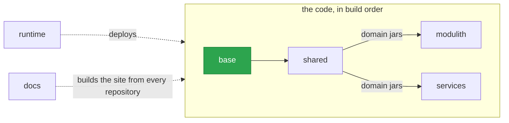

# FF Logistic: base libraries

**The technical building blocks every FF Logistic application builds on, with no business in them.**

Part of **[FF Logistic](https://github.com/ffetih/ff-logistic-docs)**: one logistics product built twice, as a modular monolith and as microservices, on the same Kubernetes platform, behind one switch. The business rules are written once; only the wiring differs. Start at the hub for the whole picture.

## What's here

| Artifact | What it gives |
| :--- | :--- |
| `ff-base-bom` | Every dependency version in one place: Spring Boot, Spring Modulith, Timefold, the AWS SDK, these libraries |
| `ff-base-parent` | Java 25 and the build conventions |
| `ff-base-tenant` | The current tenant of a request or job (`TenantContext`) |
| `ff-base-web` | RFC 9457 problem responses: domain, validation, tenant, conflict, unreadable-body errors |
| `ff-base-security` | A stateless JWT resource server that sets the tenant from the token |
| `ff-base-persistence` | Tenant-aware JPA, and `MigrationArea`: each business area runs its own Flyway scripts with its own history table |
| `ff-base-events` | The transactional outbox of one process (Spring Modulith's event publication registry, in the process's own schema) |
| `ff-base-storage` | Tenant documents in an S3-compatible store, through presigned, write-once links |
| `ff-base-app` | The application chassis: health groups, the `release` group the canary analysis reads, `/api/v1/me`, and the `migrate` profile that turns the image into a migration Job |

Each library is a Spring Boot auto-configuration: adding the dependency is the whole setup.

## Build

```bash
./build.sh    # installs the BOM, the parent and the libraries into ~/.m2
```

The libraries are not published to a Maven registry: the other repositories' CI clones this one and installs it first ([decision 11](https://ffetih.github.io/ff-logistic-docs/ff-logistic/decisions.html#d11)).

## Where it fits

Six repositories: base, then shared, then modulith and services are built in that order; runtime deploys them; docs builds the documentation site from all six. This one is green.



## Read more

- This repository's page on the documentation site: [Base libraries](https://ffetih.github.io/ff-logistic-docs/base/index.html)
- The hub, with the architecture, the decisions and the plan: [ff-logistic-docs](https://github.com/ffetih/ff-logistic-docs)
- Every page, in one site: [ffetih.github.io/ff-logistic-docs](https://ffetih.github.io/ff-logistic-docs/)
